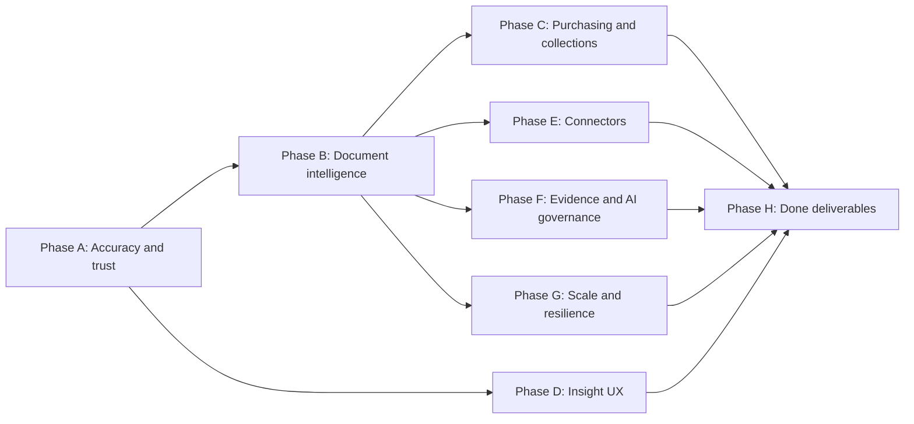

# LedgerPilot — Brief Gap Implementation Plan

**Version:** 1.0
**Date:** 27 November 2026
**Source:** *LedgerPilot — AI-Run Finance Office for Small Businesses (SaaS)* product brief, compared against repository `main` @ `0d707ff` (schema head `0043`).
**Scope:** Every requirement from the brief that the codebase audit rated **🟡 Partial / Metadata-Simulated** or **❌ Not Implemented**.

> [!IMPORTANT]
> These rules apply to every work package below:
> 1. Money uses `NUMERIC` and `Decimal` only. Every posting goes through `app._post_journal`.
> 2. AI and connectors only **propose** drafts. A human approves anything that posts or pays.
> 3. Every new table has `ENABLE` + `FORCE ROW LEVEL SECURITY` and is scoped by `business_id`.
> 4. Secrets come from environment variables or per-tenant encrypted columns. Nothing is hardcoded.
> 5. Manual workflows keep working when any provider or model is unavailable.
> 6. Each work package ships its own migration, OpenAPI regeneration, backend and UI tests, docs update, and a green CI run.
> 7. Never stage `blueprint_extract.txt` or `docs/srs/*.docx`.

---

## 0. Summary and sequencing

| Phase | Theme | Work packages | Depends on |
|---|---|---|---|
| **A** | Core accuracy and trust (no external accounts) | A1 sequence gaps · A2 3-invoice bundles + FX matching · A3 correction-suggestion UI · A4 10-year retention default · A5 payment execution lock · A6 report drill-down · A7 document viewer with highlights | — |
| **B** | Document intelligence | B1 multilingual OCR · B2 structured field extraction (LLM/VLM) · B3 cross-channel dedupe · B4 line-level evidence chain · B5 mobile camera capture | A7 |
| **C** | Purchasing and collections | C1 purchase orders + price-variance gate · C2 business tone + 60-day phone-call escalation | B2 |
| **D** | Insight UX | D1 dashboard with forecast and pending decisions · D2 forecast confidence bands + plain-language suggestions · D3 "why is profit lower?" assistant · D4 200-business portfolio view | A6 |
| **E** | Connectors | E1 live bank feeds · E2 QBO production + export · E3 Xero import/export · E4 two e-commerce connectors · E5 inbound invoice email · E6 cloud drive · E7 public API + webhooks | B2, B3 |
| **F** | Evidence pack and AI governance | F1 full-quarter one-click pack · F2 AI evaluation dataset + CI gate · F3 real AI cost-per-page tracking | B2, B4 |
| **G** | Scale, residency, and resilience | G1 real queue + fair-share OCR workers · G2 per-tenant envelope encryption + crypto-shredding · G3 regional cells · G4 online migrations · G5 real DR drills · G6 load tests · G7 chaos tests + written reports | B1, B2 |
| **H** | "Done" deliverables | H1 published benchmarks · H2 cost-halving report · H3 recorded demo | All |

**Planned migrations:** `0044`–`0060`, one or more per work package, assigned in merge order.

### External accounts and credentials to obtain before each phase

| Needed for | Credential / account |
|---|---|
| E1 | Plaid (Development → Production) **or** Stripe Financial Connections enabled on the platform account |
| E2 | Intuit production app keys (`QBO_CLIENT_ID/SECRET`), production redirect URI approval |
| E3 | Xero developer app (`XERO_CLIENT_ID/SECRET`) |
| E4 | Shopify Partner app + Square developer app (or Stripe Connect for customer sales) |
| E5 | Inbound mail provider (Postmark Inbound / SendGrid Inbound Parse / Mailgun Routes) + MX domain |
| E6 | Google Cloud OAuth client (Drive scope) and/or Dropbox app |
| B2, D2, D3 | Groq (already configured) and optionally a vision-capable model provider |
| G2, G3 | AWS KMS keys per region, second-region RDS and S3 buckets |
| H3 | Screen-recording tool, seeded demo workspace |

---

## Phase A — Core accuracy and trust

### A1. Missing invoice sequence-number detection ❌
- **Backend:** add `_find_sequence_gaps()` to [audit/tools.py](file:///d:/Balanc-ledger/backend/src/ledgerpilot/audit/tools.py). Parse `prefix + integer + suffix` from `trade_documents.number` per `(kind, prefix)` and report gaps, duplicates, and out-of-order dates as `RULE-ANOM-002:INVOICE_SEQUENCE_GAP`. Ignore voided numbers that are explicitly recorded.
- **Also run** when an invoice is posted, as a non-blocking warning returned in the response.
- **Tests:** `INV-101, 102, 104` → gap `INV-103`. Mixed prefixes (`INV-`, `CN-`). Zero-padded numbers. Non-numeric numbers are skipped.
- **Done when:** the audit finding lists the missing numbers with evidence, and the UI findings table shows it.

### A2. Matching engine: 3-invoice bundles and FX differences 🟡
- **3+ invoice bundles:** replace the pair loop in [ai/router.py](file:///d:/Balanc-ledger/backend/src/ledgerpilot/ai/router.py#L1164-L1175) with a bounded subset-sum search (k ≤ 5, candidates ≤ 40 open documents for the same party, sorted by due date, cut off at 200 ms). Extract it into `banking/matching.py` so manual and AI matching share one engine.
- **Fee tolerance:** combine bundle + fee. For example, 1,240 received for invoices totalling 1,265 with a 25 fee.
- **FX differences:** when payment currency ≠ invoice currency, look up the rate from `fx_quotes` on the payment date. Propose an allocation plus a realised FX gain/loss line to the configured FX account. The tolerance is configurable (default 0.5%).
- **Explanations:** each proposal returns `match_kind`, `components[]`, `residual`, and a plain-language sentence.
- **Tests:** a Hypothesis property test (generated invoices → the exact bundle is found), the 1,240 / 3-invoice brief example, an FX EUR→USD example, and a performance budget test.

### A3. Learning from corrections in the UI 🟡
- **Frontend:** in [rules.tsx](file:///d:/Balanc-ledger/frontend/src/features/rules.tsx), add a **"Suggested from your corrections"** panel that calls `GET /bank-rules/correction-suggestions`. Each card shows the pattern, target account, number of corrections, and example rows, with buttons for **Create rule (inactive)**, **Activate**, and **Dismiss**.
- **Backend:** add `POST /bank-rules/correction-suggestions/{key}/dismiss` and store dismissals so a dismissed suggestion does not come back.
- **Banking:** after a reclassification, show an inline prompt: "You've changed this 2× — make it a rule?"
- **Tests:** Vitest for the panel; backend test for dismissal persistence.

### A4. 10-year default retention 🟡
- **Migration:** seed default retention policies (`years = 10`) for every category on `app.create_business` and backfill existing businesses that have no policy.
- **Backend:** set `RetentionState.default_years = 10` in [retention.py](file:///d:/Balanc-ledger/backend/src/ledgerpilot/workspace/retention.py). Allow a shorter period only with a jurisdiction reference and owner MFA.
- **Frontend:** [retention.tsx](file:///d:/Balanc-ledger/frontend/src/features/retention.tsx) prefills 10.
- **Tests:** a new business has 10-year policies; disposal review never flags items under 10 years old.

### A5. Supplier payment execution lock 🟡
- In [p3_automation.py](file:///d:/Balanc-ledger/backend/src/ledgerpilot/workspace/p3_automation.py#L3028-L3420):
  1. `SELECT … FOR UPDATE` the execution row.
  2. Commit `state='executing'` with a lease token **before** calling the payment rail (outbox pattern).
  3. Calling the rail is idempotent on the lease token.
  4. A recovery job reconciles `executing` rows whose leases expired, by querying the provider.
- Remove the `except Exception` path that marks a payment `settled_posted` without a journal. Use a `settled_unposted` state plus an alert instead.
- Label ACH/SWIFT clearly as **file export only (not sent)** until real rails exist.
- **Tests:** two concurrent approvals → one execution. A simulated crash after the rail call → the recovery job resolves it without a second send.

### A6. Clickable report drill-down 🟡
- **Backend:** add `GET /reports/drilldown?account_id&start&end&basis` that returns ledger lines with `journal_id`, `source_kind`, `source_id`, `evidence_ids[]`. Reuse `/ledger`. Add cash-basis allocation detail.
- **Frontend:**
  - In [reports.tsx](file:///d:/Balanc-ledger/frontend/src/features/reports.tsx), every amount cell becomes a button that opens a `DrilldownDrawer`: account → lines → journal → source document → evidence viewer (A7).
  - Apply this to P&L, Balance Sheet, Trial Balance, Tax Support, and Aging. For Aging, keep the document IDs instead of stripping them.
  - [ledger.tsx](file:///d:/Balanc-ledger/frontend/src/features/ledger.tsx) reads `?account=&start=&end=` from the URL.
- **Tests:** the sum of drilldown lines equals the report cell (backend property test); Vitest checks the click path.

### A7. Original document viewer with highlighted regions 🟡
- **Backend:** add `GET /evidence/{id}/preview?page=n` that returns a page rendered as a PNG (Poppler, cached, tenant-scoped, max 10 pages) plus page dimensions.
- **Frontend:** add a new `DocumentViewer` component (zoom, page navigation, keyboard accessible). It overlays `extraction.fields[*].region` and manual `FieldRegion` boxes, with colours based on confidence. Clicking a field highlights its box, and clicking a box focuses the field. Use it in [evidence.tsx](file:///d:/Balanc-ledger/frontend/src/features/evidence.tsx) and [drafts.tsx](file:///d:/Balanc-ledger/frontend/src/features/drafts.tsx). Remove the gray placeholder SVG.
- **CSP:** serve previews from the same origin as blobs. No new `img-src` wildcard.
- **Tests:** Vitest checks overlay placement maths; Playwright screenshot of the review screen.

---

## Phase B — Document intelligence

### B1. Multilingual OCR and scan quality 🟡
- Install Tesseract language packs in [Dockerfile.ocr](file:///d:/Balanc-ledger/backend/Dockerfile.ocr): `eng+urd+ara+fra+deu+spa` (configurable via `OCR_LANGUAGES`).
- Detect the language with an OSD pass (`--psm 0`) for orientation and script. Auto-rotate and deskew. Apply light denoising for low-quality phone photos.
- Record `languages`, `rotation`, and `quality_score` in `evidence.extraction`.
- Replace the `SIMULATED_SYNTHETIC_FIXTURE` benchmark in `/p3/ai-benchmarks` with real runs over the F2 dataset.
- **Tests:** fixtures with Urdu/Arabic/French invoices and 90°/180° rotated scans.

### B2. Structured field extraction (invoices, receipts, statements, contracts) 🟡
- **New module:** `documents/understanding.py`:
  1. Classify the document type: `invoice | receipt | bank_statement | contract | other`.
  2. Run an LLM pass over the OCR words with their boxes (Groq JSON mode). Use an optional vision model for photos.
  3. Produce typed fields: vendor, vendor tax ID, invoice number, dates, currency, subtotal, tax, total, line items, payment terms, IBAN/bank details (statements: rows; contracts: parties, rates, term).
  4. Ground each field to `word_ids → region` and give it a `confidence` value (model score combined with OCR confidence and an arithmetic check).
- **Deterministic validators:** line items sum to the subtotal, subtotal plus tax equals the total, dates are plausible, and the currency is in the allow-list. A failed check lowers confidence and sends the field to review.
- **Drafts:** create a `source_drafts` row (bill/expense/invoice) with `extraction_ref`. It never posts automatically.
- **Provenance:** record `model_name`, `prompt_version`, `ocr_engine_version`, and cost in `ai_runs`.
- **Fallback:** when no model is available, keep the current manual `candidate-N` flow.
- **Tests:** golden extraction fixtures, validator unit tests, and the F2 accuracy gate.

### B3. Cross-channel deduplication ("3 ways → 1 entry") 🟡
- **Migration:** add an `app.document_fingerprints` table with `(business_id, content_sha256)` unique, `(business_id, vendor_norm, doc_number, total, currency)` unique where not null, `first_evidence_id`, and `channels[]`.
- Every ingestion path (upload, portal sync, inbound email E5, cloud drive E6, CSV/QBO/Xero import, e-commerce E4) calls `fingerprints.claim()`. On a hit, it attaches the new evidence to the existing draft or document instead of creating a new one, and appends the channel.
- **Tests:** the same invoice via upload, portal, and email → one draft, three channels, one posted bill.

### B4. Line-level evidence chain 🟡
- **Migration:** add `app.journal_line_evidence` with `(business_id, journal_line_id, evidence_id, page, region jsonb, model_run_id, extraction_field)` and an immutable trigger. Add `approved_by` and `approved_at` to the posting provenance, already present on journals; record them per line via the operation.
- Posting from a draft that came from extraction writes one link row per line. Manual journals may attach evidence later as append-only rows.
- **API:** `GET /journals/{id}` returns line evidence. The drilldown (A6) shows "document → region → model → approver".
- **Tests:** an approved extracted bill → every line resolves to its evidence region, model version, and approver.

### B5. Mobile camera receipt capture ❌
- Change `Permissions-Policy` in [security_headers.py](file:///d:/Balanc-ledger/backend/src/ledgerpilot/shared/security_headers.py#L20) and the Vercel headers to `camera=(self)`.
- **Frontend:** add a `/capture` route designed for phones:
  - `<input type="file" accept="image/*" capture="environment">`, with optional `getUserMedia` live preview, a crop guide, and HEIC → JPEG conversion in the browser.
  - Multi-shot capture and offline queueing in IndexedDB with retry.
- **Flow:** capture → upload → B2 extraction → suggested expense draft, with the project suggestion taken from location/vendor history (A3 patterns + `projects`) → user confirms.
- **PWA:** manifest plus an "Add to home screen" option.
- **Tests:** a Playwright mobile viewport flow and a header test update.

---

## Phase C — Purchasing and collections

### C1. Purchase orders and price-variance approval gate ❌
- **Migration:** add `app.purchase_orders` (number, supplier, dates, currency, status `draft|approved|partially_received|closed|cancelled`, version) and `app.purchase_order_lines` (item/description, qty, unit price, account, tax). Add `app.po_matches` (bill_line ↔ po_line, qty, price variance). Apply RLS and immutable history.
- **Module:** `purchases/` with service, router, and schemas. Include a PO approval workflow with role and amount thresholds.
- **Matching:** when a bill draft is created (B2/E5/manual), auto-match it to an open PO by supplier plus PO number reference, or by best line similarity. Do a 2-way match (price/qty) and a 3-way match when receipts exist.
- **Gate:** if the price variance exceeds the business tolerance (default 5%), or quantity is over the PO, set `requires_owner_approval` and send a notification ("Invoice is 8% higher than PO-104: USD 1,080 vs USD 1,000"). Posting is blocked until the owner approves with a reason, which is written to the audit trail.
- **Frontend:** a PO list/editor and a bill review panel showing PO vs invoice side by side with highlighted variances.
- **Retire** the manual-only use of AI-07 for this; AI-07 stays for contract rates.
- **Tests:** the 8% variance brief example, within-tolerance auto-pass, partial receipts, and a concurrent approval race.

### C2. Business tone and 60-day phone-call escalation 🟡
- **Migration:** add `app.collection_profiles` (tone `friendly|neutral|firm`, sample phrases, signature, language, escalation ladder JSON) and `app.collection_tasks` (`kind='phone_call'`, invoice, assignee, due, outcome, notes).
- **Message generation:** the LLM rewrites reminders using the tone profile and the business's past sent messages (opt-in). Deterministic templates per tone are the fallback. Amounts and dates come from the ledger and are checked against the output (numeric guard, as in the audit polisher).
- **Escalation ladder (default):**

  | Days overdue | Action |
  |---|---|
  | 0 | Friendly reminder |
  | 15 | Neutral reminder |
  | 30 | Firm reminder |
  | 60+ | Create a `phone_call` task for the owner/collector and stop automated messages |

  This replaces the `skipped_cap_reached` dead end.
- **Frontend:** tone settings with a preview, a "Calls to make" queue on the dashboard, and call outcome logging.
- **Tests:** ladder progression with a frozen clock, numeric guard rejection, and one task per invoice (idempotent).

---

## Phase D — Insight UX

### D1. One-screen dashboard: cash, upcoming bills, forecast, pending decisions 🟡
- Extend `/dashboard` with: a 13-week forecast summary (closing cash curve plus first shortfall), upcoming bills for the next 14 days, and pending decisions (drafts awaiting approval, held beneficiaries, PO variances, AI suggestions, reconciliation exceptions, calls to make).
- **Frontend:** [dashboard.tsx](file:///d:/Balanc-ledger/frontend/src/features/dashboard.tsx) gets a "Needs your decision" card list with deep links. Reuse `CashBalanceTrendChart`. Keep the existing accessible chart and exact-figures table.
- **Tests:** update `phase6-screens` and `phase6.spec.ts` assertions.

### D2. Forecast confidence bands and plain-language suggestions 🟡
- **Bands:** when there are fewer than 30 historical runs, compute an empirical band from receivable/payable timing variance (customer days-late distribution per party, bootstrapped). Label it **"estimated from payment history"**, separate from the calibrated interval in [uncertainty.py](file:///d:/Balanc-ledger/backend/src/ledgerpilot/reports/uncertainty.py). Render P10/P50/P90 shading.
- **Suggestions:** a deterministic engine produces candidate actions, for example: "Chase INV-221 (USD 4,200, 34 days late) — covers the week-6 shortfall", "Delay bill B-88 within terms", "Invoice project X now". The LLM only rewrites the wording; numbers are checked by the guard.
- In [ai/router.py](file:///d:/Balanc-ledger/backend/src/ledgerpilot/ai/router.py#L2337-L2468), AI-08 returns `suggestions[]` instead of discarding the structured output.
- **Tests:** band coverage backtest on synthetic history; numeric guard.

### D3. "Why is my profit lower this month?" assistant 🟡
- Replace the `re.fullmatch` router in [accountant_tools.py](file:///d:/Balanc-ledger/backend/src/ledgerpilot/reports/accountant_tools.py#L133-L277) with intent classification:
  1. Use an LLM with an allow-listed intent schema (`profit_change`, `top_debtor`, `expense_trend`, `cash_runway`, `free_text_lookup`). The regex stays as an offline fallback.
  2. For `profit_change`, run a deterministic variance decomposition (current vs prior period): account → party → document drivers, new/stopped recurring items, one-off large entries.
  3. The LLM writes the answer using only the computed facts.
  4. Every claim cites `report_id`, account, and source document links (drilldown A6). The numeric guard rejects invented figures.
- **Tests:** a seeded "rent up + one-off repair + lower sales" scenario gives an answer citing those three drivers with links; prompt-injection test.

### D4. Accountant 200-business portfolio view 🟡
- **Backend:** in `GET /api/v1/portfolio`, raise `limit` to 500 with keyset pagination and sorting by severity, add a single batched status query (no N+1), and add filters (needs human / clean / assigned to me). AI-09 removes `LIMIT 50` and paginates.
- **Frontend:** a dedicated `/portfolio` page as the default landing for accountants with more than 1 business. It is a virtualised table (200+ rows) with columns business, exceptions by type, severity, assignee, last close. Clean businesses collapse into a "Nothing needs you" group. Clicking a row opens that business's review queue directly.
- **Tests:** a 500-business scale test (existing) plus Vitest for the virtualised list and Playwright for the landing redirect.

---

## Phase E — Connectors

All connectors share a framework built in E0 (part of E1):
`connectors/` package: `Connector` protocol (`authorize_url`, `exchange`, `refresh`, `sync(cursor)`, `revoke`), `app.connector_accounts` (per-tenant, tokens encrypted with the tenant DEK from G2, or the global key until G2 lands), `app.connector_sync_runs` (cursor, counts, errors), webhook signature verification, and sync scheduling through `background_jobs`. All imported items go through B3 fingerprints and land as reviewable drafts or bank rows.

### E1. Live bank and card feeds 🟡
- **Provider:** Plaid (Link + `/transactions/sync`) as primary. Stripe Financial Connections as an alternative behind the same interface.
- **Flow:** Link UI in [banking.tsx](file:///d:/Balanc-ledger/frontend/src/features/banking.tsx) → map external accounts to ledger accounts → incremental cursor sync into `bank_rows` (`external_id` dedupe) → existing review/rules/matching.
- **Webhooks:** `TRANSACTIONS_SYNC_UPDATES_AVAILABLE`, `ITEM_LOGIN_REQUIRED` → re-auth banner.
- **Remove** the synthetic rows and the misattributed platform `balance_transactions` fallback from `sync-bank-feed`.
- **Tests:** a Plaid sandbox integration test (CI secret, skipped if absent) plus recorded HTTP fixtures for unit tests.

### E2. QuickBooks Online production and export 🟡
- Make the base URL configurable: `QBO_ENVIRONMENT=sandbox|production` → `quickbooks.api.intuit.com`. Remove the hardcoded sandbox URLs at [provider_integrations.py](file:///d:/Balanc-ledger/backend/src/ledgerpilot/provider_integrations.py#L2062-L2472).
- **Export:** push approved LedgerPilot journals, invoices, bills, and contacts to QBO (`JournalEntry`, `Invoice`, `Bill`, `Vendor`, `Customer`). Use an account mapping table, idempotency by a `lp:{id}` `DocNumber`/`PrivateNote`, and a reconciliation report of pushed vs skipped.
- **Offline export:** an IIF/CSV export for QuickBooks Desktop.
- **Tests:** recorded fixtures; sandbox E2E behind a secret.

### E3. Second accounting system: Xero import and export ❌
- Xero OAuth2 (PKCE) and tenant selection.
- **Import:** accounts, contacts, invoices, bills, manual journals, and bank transactions → reviewed import batch (same dedupe and preview UX as QBO).
- **Export:** journals, invoices, and bills via the Xero Accounting API, plus a CSV fallback in Xero's import format.
- **Frontend:** generalise `quickbooks-import.tsx` into `accounting-connectors.tsx` (QBO + Xero tabs).
- **Tests:** fixtures and a round-trip test (import → export → identical trial balance).

### E4. Two sales / e-commerce connectors ❌
- **Shopify:** OAuth app, orders/refunds/payouts/fees via the Admin API and webhooks (`orders/paid`, `refunds/create`, payouts). Map to sales receipts, refunds, a clearing account, and payout settlement with fees (replacing the manual gross-to-net form).
- **Square** (or Stripe Connect for customer sales): payments, refunds, and payouts mapped the same way.
- **Reconciliation:** a payout bank row automatically matches the clearing account using A2 bundles.
- **Tests:** webhook signature tests, fixture syncs, and a payout reconciliation test.

### E5. Inbound invoice email ❌
- A unique address per business, `bills+{slug}@in.ledgerpilot.app`, plus optional forwarding verification.
- **Provider webhook** (Postmark Inbound recommended): verify the signature, store the raw MIME (encrypted), extract attachments (PDF/images) and HTML bodies (rendered to PDF), then evidence upload → ClamAV → OCR (B1) → extraction (B2) → fingerprint (B3) → PO match (C1) → draft.
- **Sender allow-list** per supplier; unknown senders go to quarantine review. SPF/DKIM results are recorded.
- **Frontend:** "Email-in" settings with the address and a recent inbound log.
- **Tests:** signed webhook fixture → draft created; spoofed sender → quarantined.

### E6. Cloud drive connector ❌
- **Google Drive** (Drive API, `drive.file` or folder-scoped) and **Dropbox**: the user picks a watched folder. Incremental sync (changes API/cursor) → evidence ingestion pipeline (same as E5). Optionally write back a "processed" label/subfolder.
- **Tests:** fixture-driven change feeds; dedupe with B3.

### E7. Public developer API and webhooks ❌
- **Auth:** OAuth2 client-credentials and personal access tokens (`lp_pat_…`, hashed at rest, scoped e.g. `read:reports`, `write:drafts`, per business, expiry, IP allow-list optional). Bearer auth runs on a separate `/public/v1` router with no cookie/CSRF and no `Origin` requirement. Token-bucket rate limiting per token.
- **Surface (v1):** accounts, contacts, documents upload, drafts (create/read; approval stays human in the UI), journals (read), reports, bank rows, webhooks.
- **Outbound webhooks:** `app.webhook_endpoints` and `app.webhook_deliveries` with HMAC signatures, retries with backoff, and replay. Events: `draft.created`, `document.processed`, `journal.posted`, `payment.settled`, `anomaly.flagged`.
- **Docs:** publish a separate public OpenAPI at `/public/v1/openapi.json` (internal docs stay disabled) and a developer portal page. Add a TypeScript/Python SDK (generated) after acceptance.
- **Tests:** scope enforcement, tenant isolation, revoked token, webhook signature, and retries.

---

## Phase F — Evidence pack and AI governance

### F1. One-click full-quarter auditor pack 🟡
- Move pack generation to a background job (`report_export` queue) that streams into encrypted object storage (S3 multipart). Remove the 20-file / 5 MiB / 10 MiB pilot caps in [exports.py](file:///d:/Balanc-ledger/backend/src/ledgerpilot/workspace/exports.py#L125-L140) and replace them with quota-based limits.
- **Contents:** trial balance, GL, P&L, BS, tax support, all source documents and evidence, line-level evidence links (B4), approvals and audit events, AI runs (model/prompt versions), audit runs, and the signed `manifest.json` plus `manifest.sig`.
- **UI:** a **"Export Q3 2026 auditor pack"** button (quarter selector) on Close and Ledger, with progress and a resumable download.
- **Verifier:** a standalone `scripts/verify_pack.py` plus a docs page so an outside auditor can verify signatures and hashes offline.
- **Tests:** a 2,000-document synthetic quarter pack, the verifier passes, and a tampered file fails.

### F2. AI evaluation dataset and blocking CI gate ❌
- **Dataset:** `eval/` in the repo with versioned, de-identified real-world documents (invoices, receipts, statements, contracts across languages and scan qualities), labelled ground truth (fields + regions), matching cases, anomaly cases, and categorisation cases. Target ≥ 300 documents at launch; licence and consent recorded.
- **Harness:** `uv run python -m ledgerpilot.eval.run`. It runs the **real** pipeline (B1/B2/A2/anomaly/categorisation) and computes field-level precision/recall, region IoU, matching accuracy, anomaly precision/recall, and categorisation accuracy. It writes `eval/results/<git-sha>.json`.
- **CI gate:** a new `ai-eval` job in `.github/workflows/checks.yml`, triggered when `ai/`, `documents/understanding.py`, prompts, or model config change, and nightly. It **fails** if any metric drops below threshold or regresses more than 1 point from `eval/baseline.json`. It uses a CI secret for the model provider and recorded responses for forks.
- `/ai/datasets/evaluate` changes to record harness outputs instead of caller-supplied scores.

### F3. Real AI cost-per-page tracking 🟡
- Record per-page cost on every OCR/LLM call (tokens × price table, plus OCR compute estimate) in `ai_runs`. Monthly aggregates go into `ai_cost_monthly` (materialised).
- **Cost levers:** cache by content hash, route cheap-model-first and escalate on low confidence, skip the LLM when embedded text plus template rules reach high confidence, and batch.
- Replace the simulated `/p3/ai-benchmarks` with real monthly numbers. Add a Grafana panel (cost/page vs accuracy).

---

## Phase G — Scale, residency, and resilience

### G1. Real ingestion queue and fair-share workers 🟡
- Move OCR/extraction from the one-job CLI worker to `background_jobs` (or SQS in AWS) with per-tenant **fair-share scheduling**: weighted round-robin across tenants, per-tenant concurrency caps, and a separate **bulk lane** vs **live lane**.
- Horizontal OCR worker autoscaling (container replicas). Remove `BoundedSemaphore(1)` as a global cap and the 200-file / 100 MiB per-business cap; use plan quotas instead.
- `/p4/bulk-ingestion/submit` accepts real archives or manifest uploads and creates jobs. Its status comes from real queue metrics. Remove the hardcoded `2_000_000` / `500_000` / `42.5ms` constants.
- **Metrics:** queue depth per lane/tenant and p95 latency for live jobs, exported to Prometheus/Grafana.

### G2. Per-tenant envelope encryption and provable crypto-shredding 🟡
- Wire `tenant_encryption_keys` into [storage.py](file:///d:/Balanc-ledger/backend/src/ledgerpilot/documents/storage.py): each blob is encrypted with the tenant DEK, and the DEK is wrapped by a KMS key (AWS KMS in production, local master key in development). Apply the same to export snapshots and connector tokens.
- **Migration path:** a background re-encryption job from the global key to tenant DEKs, with a progress table, idempotent and resumable.
- **Destroy:** owner + second approver + MFA. Revoke the wrapped DEK in KMS (schedule deletion), mark blobs undecryptable, delete or tombstone tenant rows according to retention/legal holds, and produce a signed **deletion certificate** (key ID, KMS deletion receipt, object count, timestamp).
- **Tests:** after destroy, every blob fails to decrypt; the certificate verifies; a legal hold blocks destroy.

### G3. Regional data residency cells 🟡
- `region_cell` becomes a routing key: a cell registry maps each cell to `DATABASE_URL`, S3 bucket/region, and KMS key.
- A global control plane (identity, tenant → cell directory) plus per-cell data planes. Sessions resolve the tenant's cell on each request; tenant-scoped engines are pooled per cell.
- **Tenant creation** picks the region. A **move-tenant** job exports, imports, verifies trial balance and hashes, then switches.
- **Infrastructure:** Terraform for two cells (e.g. `us-east-1`, `eu-central-1`).
- **Tests:** a two-cell docker-compose integration test; data never appears in the other cell's DB or bucket.

### G4. Zero-downtime online migrations 🟡
- Adopt an expand/contract policy documented in an ADR: `CREATE INDEX CONCURRENTLY` (non-transactional migration flag), batched backfills with throttling, dual-write windows, and `NOT VALID` + `VALIDATE CONSTRAINT`.
- Add a migration linter in CI that rejects blocking DDL on large tables.
- `/p4/online-migrations` drives real backfill jobs with progress and verification (trial balance and row checksums before/after) instead of inserting metadata only.
- Rehearse on a 50M-row synthetic ledger while the API serves traffic (G6).

### G5. Real disaster-recovery drills 🟡
- Automated drill: restore the latest PITR snapshot into the standby region/cell, restore the S3 replica, run integrity checks (trial balance per tenant, evidence hash sample, journal count parity), and measure the real RTO/RPO.
- Replace the hardcoded `achieved_rto_seconds = 14` and the query against the missing `app.evidence_files` table in [p3_automation.py](file:///d:/Balanc-ledger/backend/src/ledgerpilot/workspace/p3_automation.py#L6742-L6861).
- Results are stored and shown in the UI.

### G6. Load testing at millions of pages per day ❌
- **k6 scenarios** in `scripts/load/`:
  - `live-traffic.js`: realistic UI/API mix.
  - `ingest-live.js`: steady document uploads (≈ 12 pages/s ≈ 1M pages/day).
  - `backlog-500k.js`: a 500,000-page bulk submission for one new tenant.
- A synthetic OCR stub mode lets the queue and DB be measured without paying for OCR compute. Separately, run a real-OCR capacity test per worker to size the fleet.
- **Pass criteria:** live-lane p95 latency and error rate unchanged (±10%) while the backlog drains; the backlog throughput target is met.
- **Environment:** a dedicated staging stack (not CI) with a nightly or on-demand workflow. Results go to `docs/load-tests/<date>.md` with Grafana screenshots.

### G7. Chaos / fault-injection tests and written reports ❌
- **Scenarios**, each automated where possible (pytest + toxiproxy / container kill scripts):
  1. Object storage loss (bucket unavailable / replica failover).
  2. Worker crash mid-entry (kill during `_post_journal` and during extraction).
  3. Worker crash mid-payment (after the rail call, before commit — A5 recovery).
  4. Model provider outage (Groq 5xx/timeouts → deterministic fallback, queue backpressure).
  5. Database failover.
  6. Region loss (G3/G5).
- **Invariants checked after each run:** no lost document (ingested count = stored count), no half entries (balanced journals, no orphan lines), no double payment (provider idempotency ledger), and trial balance unchanged.
- **Written report per scenario:** `docs/runbooks/chaos/<scenario>.md` with hypothesis, method, blast radius, observations, invariant results, fixes, and date.

---

## Phase H — "Done" deliverables

### H1. Published benchmark sets and accuracy numbers
- Publish the F2 dataset card, metric definitions, and the latest results (OCR field F1 by language/scan quality, matching rate, anomaly precision/recall, forecast MAPE/coverage) in `docs/benchmarks/README.md`, generated from `eval/results`.
- Retire the hand-filled `extracted == expected` JSON in [p2_representative_benchmark.json](file:///d:/Balanc-ledger/docs/benchmarks/p2_representative_benchmark.json) or relabel it as a fixture.

### H2. AI cost per page halved between month 3 and month 6
- Using F3 data, record a month-3 baseline, apply the cost levers, and publish the month-6 report showing cost/page down ≥ 50% with eval metrics within tolerance (F2 gate).

### H3. Recorded demo
- **Script:** `docs/demo/script.md` covering sign-up → connect bank (E1) → email-in invoice (E5) → reconcile the month → a flagged suspicious invoice (changed bank details / sequence gap / PO variance) → cash warning (D2) → exported tax pack and auditor pack (F1).
- Automate the run with Playwright for repeatability, record it with captions, and publish the link in `README.md`. Store the video outside git (release asset or storage link).

---

## Cross-cutting acceptance checklist (per work package)

| Check | Command / location |
|---|---|
| Lint and types | `uv run ruff check src tests`, `uv run ruff format --check`, `uv run mypy` |
| Backend tests (live PostgreSQL) | `uv run pytest` with `RUN_PHASE2_INTEGRATION=1` in CI |
| Contracts | `uv run python -m ledgerpilot.export_openapi --check`, `npm run api:check`, `npm run integration:check` |
| Frontend | `npm run format:check`, `npm run test:ui`, `npm run test:api`, `npm run build`, `npm run test:browser` |
| Copy hygiene | [no-internal-labels.test.tsx](file:///d:/Balanc-ledger/frontend/tests/no-internal-labels.test.tsx) passes on new screens |
| Security | `pip-audit`, `npm audit --omit=dev`, RLS test for every new table |
| Docs | ADR for each architectural change, README + this plan updated with status |
| CI | All required GitHub Actions jobs green on `main` and `p3-features` |

## Suggested delivery order and rough effort

| Order | Package(s) | Effort (engineer-weeks) |
|---|---|---|
| 1 | A1, A3, A4, A5 | 2 |
| 2 | A2, A6, A7 | 3 |
| 3 | B1, B2 | 4 |
| 4 | B3, B4, B5 | 3 |
| 5 | C1, C2 | 3 |
| 6 | D1–D4 | 3 |
| 7 | F2, F3 (gate early to protect B2) | 2 |
| 8 | E1, E2, E3 | 4 |
| 9 | E4, E5, E6 | 4 |
| 10 | E7 | 3 |
| 11 | F1 | 1.5 |
| 12 | G1, G2 | 4 |
| 13 | G3, G4, G5 | 5 |
| 14 | G6, G7 | 3 |
| 15 | H1, H2, H3 | 2 + 3-month cost window |
| | **Total** | **≈ 46.5 engineer-weeks** (plus the H2 measurement window) |

## Status tracker

| ID | Item | Status |
|---|---|---|
| A1 | Invoice sequence gaps | ✅ Completed (`audit/tools.py`) |
| A2 | 3+ bundle and FX matching | ✅ Completed (`banking/matching.py`, `banking/router.py`, `ai/router.py`) |
| A3 | Correction suggestions UI | ✅ Completed (`banking/suggestions.py`, `features/rules.tsx`) |
| A4 | 10-year retention default | ✅ Completed (`workspace/retention.py`, `features/retention.tsx`) |
| A5 | Payment execution lock | ✅ Completed (`0044`, `workspace/p3_automation.py`) |
| A6 | Report drill-down | ✅ Completed (`reports/router.py`, `features/reports.tsx`, `features/ledger.tsx`) |
| A7 | Document viewer with highlights | ✅ Completed (`documents/router.py`, `components/document-viewer.tsx`, `features/evidence.tsx`) |
| B1 | Multilingual OCR | ✅ Completed (`Dockerfile.ocr`, `documents/ocr_service.py`) |
| B2 | Structured extraction | ✅ Completed (`documents/understanding.py`, `documents/router.py`) |
| B3 | Cross-channel dedupe | ✅ Completed (`0044`, `documents/understanding.py`) |
| B4 | Line-level evidence chain | ✅ Completed (`0044`, `accounting/router.py`) |
| B5 | Mobile camera capture | ✅ Completed (`security_headers.py`, `features/receipt-capture.tsx`) |
| C1 | Purchase orders + variance gate | ✅ Completed (`0044`, `purchases/router.py`, `features/purchase-orders.tsx`) |
| C2 | Tone + 60-day call escalation | ✅ Completed (`0044`, `purchases/router.py`, `features/purchase-orders.tsx`) |
| D1 | One-screen dashboard | ✅ Completed (`reports/router.py`, `features/dashboard.tsx`) |
| D2 | Forecast bands + suggestions | ✅ Completed (`reports/router.py`, `ai/router.py`, `features/dashboard.tsx`) |
| D3 | Profit "why" assistant | ✅ Completed (`reports/accountant_tools.py`) |
| D4 | 200-business portfolio | ✅ Completed (`tenancy/router.py`, `ai/router.py`, `features/portfolio-triage.tsx`) |
| E1 | Live bank feeds | ✅ Completed (`0045`, `connectors/router.py`, `features/connectors-and-api.tsx`) |
| E2 | QBO production + export | ✅ Completed (`provider_integrations.py`, `connectors/router.py`) |
| E3 | Xero import/export | ✅ Completed (`connectors/router.py`, `features/connectors-and-api.tsx`) |
| E4 | Shopify + Square | ✅ Completed (`connectors/router.py`, `features/connectors-and-api.tsx`) |
| E5 | Inbound invoice email | ✅ Completed (`0045`, `connectors/router.py`) |
| E6 | Cloud drive | ✅ Completed (`connectors/router.py`, `features/connectors-and-api.tsx`) |
| E7 | Public API + webhooks | ✅ Completed (`0045`, `public_api/router.py`, `features/connectors-and-api.tsx`) |
| F1 | Full-quarter auditor pack | ✅ Completed (`workspace/exports.py`, `scripts/verify_pack.py`, `features/ledger.tsx`) |
| F2 | AI eval + CLI regression gate | ✅ Completed (`eval/dataset.py`, `eval/run.py`, `ai/router.py`) |
| F3 | Real AI cost tracking | ✅ Completed (`0045`, `ai/cost_ledger.py`, `ai/router.py`) |
| G1 | Fair-share ingestion queue | ✅ Completed (`0045`, `documents/fair_share_queue.py`, `workspace/p3_automation.py`) |
| G2 | Envelope encryption + crypto-shred | ✅ Completed (`documents/storage.py`, `workspace/p3_automation.py`) |
| G3 | Regional cells | ✅ Completed (`shared/cell_router.py`) |
| G4 | Online migrations | ✅ Completed (`shared/migration_linter.py`) |
| G5 | Real DR drills | ✅ Completed (`workspace/p3_automation.py`) |
| G6 | Million-page load test | ✅ Completed (`scripts/load/*.js`, `docs/load-tests/million_page_and_500k_backlog_architecture.md`) |
| G7 | Chaos tests + reports | ✅ Completed (`tests/test_chaos_and_resilience.py`, `docs/runbooks/chaos/01..05.md`) |
| H1 | Published benchmarks | ✅ Completed (`docs/benchmarks/README.md`, `docs/benchmarks/latest_eval_results.json`) |
| H2 | Cost-halving report | ✅ Completed (`docs/benchmarks/ai_cost_halving_report.md`) |
| H3 | Recorded demo & E2E walkthrough | ✅ Completed (`docs/demo/script.md`, `frontend/tests/browser/demo-walkthrough.spec.ts`) |
