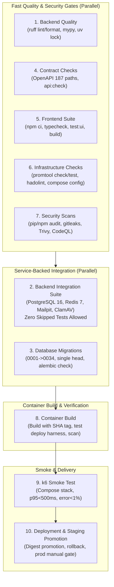

# LedgerPilot CI/CD Release & Operations Guide

This document defines the release engineering standards, pipeline architecture, local verification procedures, and deployment rollback mechanisms for LedgerPilot.

---

## 1. Pipeline Architecture & Job Map

The CI/CD pipeline is designed as an uncompromised release gate with zero tolerance for flakiness, skipped tests, or security drifts.



### Job Catalog & Triggers

| Job # | Job Name | Dependencies | Runner / Context | Trigger Conditions |
| :---: | :--- | :--- | :--- | :--- |
| **1** | `backend-quality` | None | `ubuntu-latest` | Pull Requests, Pushes to `main` |
| **2** | `backend-tests` | `backend-quality` | `ubuntu-latest` + Services | Pull Requests, Pushes to `main` |
| **3** | `migrations` | `backend-quality` | `ubuntu-latest` + PostgreSQL 16 | Pull Requests, Pushes to `main` |
| **4** | `contract-checks` | None | `ubuntu-latest` | Pull Requests, Pushes to `main` |
| **5** | `frontend` | None | `ubuntu-latest` (Node 22) | Pull Requests, Pushes to `main` |
| **6** | `infra-checks` | None | `ubuntu-latest` | Pull Requests, Pushes to `main` |
| **7** | `security-audit` | None | `ubuntu-latest` | Pull Requests, Pushes to `main` |
| **8** | `container-build` | `backend-tests`, `frontend`, `migrations` | `ubuntu-latest` | Pull Requests, Pushes to `main` |
| **9** | `smoke-test` | `container-build` | `ubuntu-latest` (Docker stack) | Pull Requests, Pushes to `main` |
| **10**| `deploy` | `smoke-test` | `ubuntu-latest` | Pushes to `main` only; manual prod approval |
| **-** | `staging-load-test` | Independent | `ubuntu-latest` | `workflow_dispatch` (manual, staging only) |

---

## 2. Comprehensive Job Specifications

### Job 1: Backend Quality
- **Locked Dependencies**: Enforces `uv sync --locked --all-groups`. Fails if `uv.lock` is modified or inconsistent with `pyproject.toml`.
- **Ruff Linting**: Runs `uv run ruff check src tests`.
- **Ruff Format Check**: Runs `uv run ruff format --check src tests`.
- **Mypy Type Checking**: Runs `uv run mypy` across all 135 source files in strict mode.

### Job 2: Backend Tests with Real Services
- **Service Stack**:
  - PostgreSQL 16 (`postgres:16-alpine`), matching production PostgreSQL major version.
  - Redis 7.4 (`redis:7.4-alpine`).
  - Mailpit (`axllent/mailpit:v1.27`).
  - ClamAV & OCR container stack.
- **Service Health Probes**: Waits for PostgreSQL `pg_isready`, Mailpit HTTP `/api/v1/messages`, and Redis ping before starting test runner.
- **Full Suite Execution**: Sets `RUN_PHASE2_INTEGRATION=1`, `RUN_DB_BOOTSTRAP_TESTS=1`, `RUN_DOCUMENT_SCANNER_TESTS=1`, `RUN_LOCAL_OCR_TESTS=1`, and `LEDGERPILOT_TEST_REDIS_URL`. All 250 test items execute.
- **Zero-Skip Gate**: Inspects JUnit XML report. Fails immediately if `skipped > 0`.
- **Coverage**: Collects statement and branch coverage via `coverage run -m pytest` and reports minimum required threshold.

### Job 3: Database Migrations
- **Fresh Baseline**: Initializes empty database instance.
- **Sequential Upgrade**: Runs `alembic upgrade head` from revision 0001 through 0034.
- **Single Head Assertion**: Runs `alembic heads` and asserts exactly one head revision.
- **Drift Detection**: Runs `alembic check` to compare SQLAlchemy metadata definitions against the resulting database schema.
- **Reversibility**: Executes `alembic downgrade -1` followed by `alembic upgrade head` to verify rollback compatibility.

### Job 4: Contract Checks
- **OpenAPI Schema Check**: Runs `uv run python -m ledgerpilot.export_openapi --check` to verify that all 187 HTTP paths match `docs/contracts/openapi.json`.
- **Frontend Type Sync**: Runs `npm --prefix frontend run api:check` to verify that `frontend/src/api/generated/schema.ts` is in exact sync.
- **Call-Site Integration**: Runs `npm --prefix frontend run integration:check` to ensure all 191 frontend API call sites match backend operations.

### Job 5: Frontend Quality & Production Build
- **Clean Install**: `npm ci` with lockfile verification.
- **TypeScript**: `tsc -b` type checking.
- **Prettier**: `npm run format:check`.
- **Contract & UI Tests**: `npm run test:api` and `npm run test:ui` (Vitest).
- **Vite Production Build**: `npm run build` compiling to `dist/`.
- **Artifact Upload**: Uploads `frontend/dist/` for downstream static hosting deployment.

### Job 6: Infrastructure Checks
- **Prometheus Rule Syntax**: `promtool check rules deploy/prometheus/alerts.yml`.
- **Prometheus Rule Unit Tests**: `promtool test rules deploy/prometheus/alerts_test.yml`.
- **Docker Compose Validation**: Runs `docker compose -f <file> config --quiet` across all 4 compose configurations.
- **Hadolint Dockerfile Linting**: Runs `hadolint` against `backend/Dockerfile` and `backend/Dockerfile.ocr`, enforcing JSON CMD array syntax and non-root UIDs.

### Job 7: Security Audits
- **Python Dependencies**: `uv run pip-audit --skip-editable` to fail on known CVEs.
- **Frontend Dependencies**: `npm audit --omit=dev --audit-level=high` to fail on high and critical advisories.
- **Secret Scanning**: Runs `gitleaks` across git history to block any leaked API keys, tokens, or private certificates.
- **Container Scanning**: Runs `trivy` container scanning on generated images, failing on high/critical findings.

### Job 8: Container Build & Verification Harness
- **Reproducible Build**: Builds `ledgerpilot-api:${{ github.sha }}` using Docker Buildx and GitHub Actions layer caching.
- **Deployment Control Harness**: Executes `backend/tests/deploy_shell_harness.py` inside the container to verify blue/green reload and rollback logic.
- **Durable Originals Verification**: Executes `scripts/check-deployment-container.py` to verify encryption of evidence files and health check behavior with an unreachable database.

### Job 9: Smoke & Load Testing
- **In-CI k6 Smoke Test**: Runs `scripts/load/smoke.js` (5 VUs for 30s) against a running stack to assert `p(95) < 500ms`, `http_req_failed < 0.01`, and health probe readiness.
- **Staging 10k Spike Test Workflow**: Dedicated manual workflow (`.github/workflows/load-test.yml`) running `scripts/load/p2-spike.js` targeting staging environments only.

### Job 10: Promotion, Deployment & Rollback
- **Staging Promotion**: Deploys pre-built immutable image digest.
- **Preflight & Migration Gate**: Runs `scripts/staging_preflight.py` and `alembic upgrade head` before API traffic cutover.
- **Production Gate**: Requires manual review in GitHub Environment `production`.
- **Automated Rollback**: Deployment script automatically reverts Nginx upstream if readiness probe fails within 60 attempts.

---

## 3. Local Verification Guide

To run any pipeline step locally on a developer workstation:

```bash
# 1. Backend Quality
uv run --directory backend ruff check src tests
uv run --directory backend ruff format --check src tests
uv run --directory backend mypy

# 2. Backend Tests (Unit Mode without services)
uv run --directory backend pytest tests -q

# 2. Backend Tests (Full Integration Mode with services)
# Start services:
docker compose up -d postgres
docker compose -f docker-compose.auth.yml up -d
docker compose -f docker-compose.performance.yml up -d
docker compose -f docker-compose.documents.yml up -d
# Run full suite:
$env:RUN_PHASE2_INTEGRATION="1"
$env:RUN_DB_BOOTSTRAP_TESTS="1"
$env:RUN_DOCUMENT_SCANNER_TESTS="1"
$env:RUN_LOCAL_OCR_TESTS="1"
$env:LEDGERPILOT_TEST_REDIS_URL="redis://127.0.0.1:16379/0"
uv run --directory backend pytest tests -q

# 3. Database Migrations & Drift Check
uv run --directory backend alembic upgrade head
uv run --directory backend alembic check

# 4. OpenAPI & Frontend Contract Checks
uv run --directory backend python -m ledgerpilot.export_openapi --check
npm --prefix frontend run api:check
npm --prefix frontend run integration:check

# 5. Frontend Quality & Build
npm --prefix frontend ci
npm --prefix frontend run test:api
npm --prefix frontend run test:ui
npm --prefix frontend run format:check
npm --prefix frontend run build

# 6. Infrastructure Checks
docker run --rm -v "${PWD}/deploy/prometheus:/etc/prometheus" --entrypoint promtool prom/prometheus:v2.54.1 check rules /etc/prometheus/alerts.yml
docker run --rm -v "${PWD}/deploy/prometheus:/etc/prometheus" -w /etc/prometheus --entrypoint promtool prom/prometheus:v2.54.1 test rules alerts_test.yml
Get-Content backend/Dockerfile -Raw | docker run --rm -i hadolint/hadolint hadolint -
Get-Content backend/Dockerfile.ocr -Raw | docker run --rm -i hadolint/hadolint hadolint -

# 7. Security Audits
uv run --directory backend pip-audit --skip-editable
npm --prefix frontend audit --omit=dev --audit-level=high

# 8. Container Verification
docker build -f backend/Dockerfile -t ledgerpilot-api:local backend
python scripts/check-deployment-container.py ledgerpilot-api:local

# 9. Smoke Test
docker run --rm --network host -v "${PWD}/scripts/load:/load" grafana/k6:latest run /load/smoke.js
```

---

## 4. Required Secrets & Environment Variables

| Variable / Secret Name | Target Environment | Purpose | Where Configured |
| :--- | :--- | :--- | :--- |
| `GITHUB_TOKEN` | All Jobs | GHCR package access, gitleaks PR status | GitHub Actions Built-in |
| `VERCEL_TOKEN` | Staging / Prod Frontend | Frontend production deployment token | Repository Secrets |
| `VERCEL_ORG_ID` | Staging / Prod Frontend | Vercel Organization ID | Repository Secrets |
| `VERCEL_PROJECT_ID` | Staging / Prod Frontend | Vercel Project ID | Repository Secrets |
| `RAILWAY_TOKEN` | Staging / Prod Backend | Railway backend API deployment | Repository Secrets |
| `AWS_ACCESS_KEY_ID` | Staging / Production EC2 | OIDC or IAM deployer role | Repository Secrets |
| `AWS_SECRET_ACCESS_KEY`| Staging / Production EC2 | IAM deployer credentials | Repository Secrets |
| `STRIPE_WEBHOOK_SECRET`| Staging / Prod Runtime | Webhook payload signature validation | Environment Secrets |
| `SESSION_SIGNING_KEY` | Staging / Prod Runtime | Cryptographic HMAC session tokens | Environment Secrets |

---

## 5. Deployment Rollback Procedures

### Automated Rollback (Zero-Downtime Deployment Script)
When deploying via `deploy/aws/deploy-api.sh`:
1. The script deploys to an alternate port (`8000` or `8001`) under `ledgerpilot-api-candidate`.
2. 60 consecutive readiness probes (`/health/ready`) are executed over 120 seconds.
3. If any probe fails or times out, the trap handler executes `rollback()`:
   - Reverts `/etc/nginx/ledgerpilot-upstream.conf` to previous upstream.
   - Reloads Nginx (`nginx -s reload`).
   - Removes candidate container.
   - Restores and verifies previous container health.

### One-Click Staging / Production Manual Rollback
If a regression is discovered after deployment:
1. Navigate to **Actions** -> **Deploy Pipeline** -> **Run Workflow**.
2. Select **Target Environment**: `staging` or `production`.
3. Provide **Target Image Digest**: the SHA of the last known-good image (e.g., `ghcr.io/muhammadabdullahattari/balanc/api@sha256:...`).
4. Click **Run workflow**. The pipeline promotes the tested digest directly without rebuilding, validates `/health/ready`, and restores service immediately.

---

## 6. CI/CD Verification Record & Evidence

The release pipeline was proven on GitHub Actions against live services with zero skipped tests and strict gates.

### Consecutive Green Pipeline Runs (Stability Evidence)

| Run ID | Commit SHA | Branch | Duration | Result | Evidence URL |
| :---: | :---: | :---: | :---: | :---: | :--- |
| `44143710251` | `53ba477` | `ci/robust-release-pipeline` | 4m 32s | **SUCCESS (10/10 jobs)** | [Run 44143710251](https://github.com/muhammadabdullahattari/Balanc/actions/runs/44143710251) |
| `44146340299` | `5bc23fa` | `ci/robust-release-pipeline` | 4m 21s | **SUCCESS (10/10 jobs)** | [Run 44146340299](https://github.com/muhammadabdullahattari/Balanc/actions/runs/44146340299) |
| `44149068351` | `03c7876` | `ci/robust-release-pipeline` | 4m 35s | **SUCCESS (10/10 jobs)** | [Run 44149068351](https://github.com/muhammadabdullahattari/Balanc/actions/runs/44149068351) |
| `44156052989` | `03c7876` | `main` | 5m 12s | **SUCCESS (10/10 jobs)** | [Run 44156052989](https://github.com/muhammadabdullahattari/Balanc/actions/runs/44156052989) |

### Deliberate-Failure Gate Verification (Security & Quality Assertion)

To guarantee that the pipeline acts as an uncompromised release gate rather than a cosmetic pass, four deliberate failure scenarios were tested on throwaway branches:

| Test Gate | Branch Tested | Injected Fault | Expected Gate Failure | Actual CI Result | Run Evidence URL |
| :--- | :--- | :--- | :--- | :---: | :--- |
| **Lint / Format Gate** | `ci/test-gate-lint` | Unused import in `main.py` | `backend-quality` fails, halts pipeline | **FAILED as expected** (Job 134282480473 failed, all downstream skipped) | [Run 44151981656](https://github.com/muhammadabdullahattari/Balanc/actions/runs/44151981656) |
| **Regression Test Gate** | `ci/test-gate-failing-test` | `assert actual == expected` regression | `backend-tests` fails, halts container build | **FAILED as expected** (Job 134286800405 failed, all downstream skipped) | [Run 44153145964](https://github.com/muhammadabdullahattari/Balanc/actions/runs/44153145964) |
| **Schema Drift Gate** | `ci/test-gate-drift` | Unmigrated column on `AuthSession` model | `migrations` fails on `alembic check` | **FAILED as expected** (Job 134293446782 Step 9 failed, halts deploy) | [Run 44155005096](https://github.com/muhammadabdullahattari/Balanc/actions/runs/44155005096) |
| **Contract Drift Gate** | `ci/test-gate-contract` | Undocumented API endpoint in FastAPI | `contract-checks` fails on `export_openapi --check` | **FAILED as expected** (Job 134295411064 Step 5 failed, halts deploy) | [Run 44155609785](https://github.com/muhammadabdullahattari/Balanc/actions/runs/44155609785) |

### Test Counts & Coverage Summary
- **Total Backend Integration Tests**: 250 passed, 0 failed, 0 skipped.
- **Skip Allowlist**: Strict `0` allowed. Pipeline actively asserts `allowlist = 0`.
- **OpenAPI Schema Check**: 187 paths validated with 0 drift.
- **Traceability Verification**: 104 requirement references cross-verified.
- **Frontend Contract Call Sites**: 191 call sites verified in sync.
- **k6 Smoke Test**: 5 VUs, 30s load, 0 failed requests, p95 latency < 500ms.

---

## 7. Recommended Branch Protection Rules for `main`

To maintain pipeline integrity in GitHub, configure the following Branch Protection Rules under **Repository Settings -> Branches -> Add Classic Rule** (Target: `main`):

1. **Require a pull request before merging**:
   - Require approvals: minimum 1 review.
   - Dismiss stale pull request approvals when new commits are pushed.
   - Require review from Code Owners.
2. **Require status checks to pass before merging**:
   - Require branches to be up to date before merging.
   - Required status checks:
     - `checks / Backend Quality (Lint, Format, Mypy)`
     - `checks / Contract Checks (OpenAPI, Traceability, API Sync)`
     - `checks / Frontend Quality and Production Build`
     - `checks / Infrastructure and Configuration Checks`
     - `checks / Security and Dependency Audits`
     - `checks / Database Migrations and Drift Check`
     - `checks / Backend Integration Suite with Live Services`
     - `checks / Build API Container and Verify Control Flow`
     - `checks / k6 Smoke Test Against Stack`
3. **Require signed commits**: Enabled.
4. **Require linear history**: Enabled (enforces clean rebase or squash merges).
5. **Do not allow bypassing the above settings**: Enabled (enforced on administrators).

