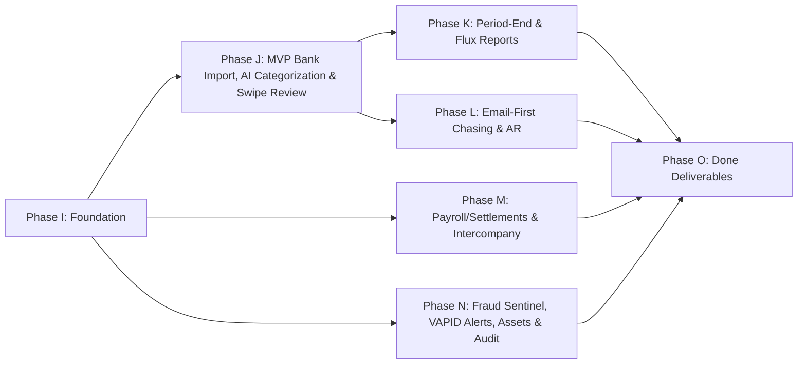

# LedgerPilot — Next-Gen v2.0 Gap Implementation Plan

**Version:** 1.2 (Implemented End-to-End — Phases I–O Complete, Schema Head `0047`)
**Date:** 28 November 2026
**Status:** ✅ All 20 work packages (`I1`–`I3`, `J0`–`J2`, `K1`–`K3`, `L1`–`L2`, `M1`–`M3`, `N1`–`N4`, `O1`–`O2`) implemented and locally verified.
**Source:** *LedgerPilot Advanced Features Implementation Blueprint* (Next-Gen v2.0 Autonomous AI Finance Office), compared against repository `main` @ `a91bba0` (schema head `0045`).
**Scope:** Every v2.0 requirement rated **🟡 Partial** or **❌ Not Implemented** in the 28 November 2026 audit, prioritized around the **MVP core first**, replacing paid enrichment/SMS/partner APIs with **LLM-first intelligence, email reminders, CSV/OFX/PDF import, and locally generated Web Push (VAPID) owner alerts**.

> [!IMPORTANT]
> Ground rules for every work package:
> 1. Money is `NUMERIC` + `Decimal` only. Every posting goes through `app.post_journal` / `app._post_journal`.
> 2. AI, connectors, and schedulers **propose** drafts. Anything that posts or pays needs a human, unless the workspace has turned on an explicit, audited auto-post policy (Decision D1).
> 3. Every new table has `ENABLE` + `FORCE ROW LEVEL SECURITY` and is scoped by `business_id`.
> 4. Secrets come from environment variables or per-tenant encrypted columns. Nothing is hardcoded.
> 5. Every external provider has a deterministic fallback. Manual workflows keep working when a provider or LLM is down.
> 6. Each package ships its migration, OpenAPI regeneration, backend and UI tests, docs update, and passes local verification (`ruff`, `mypy`, `pytest`, `api:check`, `integration:check`, `test:ui`, `build`).
> 7. Never stage `blueprint_extract.txt` or `docs/srs/*.docx`.

---

## 0. Scope Changes & Decisions Applied (v1.1)

| ID | Topic | Decision Applied in v1.1 |
|---|---|---|
| **MVP-First** | What the MVP ships first | Prioritize (1) **Bank transaction import** (CSV + **OFX/QFX** + bank-feed sync), (2) **AI categorization with double-entry journal entries**, (3) **Reconciliation & P&L / Balance Sheet reports**, and (4) **Receipt & invoice extraction** before enterprise modules. |
| **AI-Enrichment** | Merchant names, categories & locations (Module 8) | **Skip Clearbit and Google Places.** Use our existing LLM (`GroqModelAdapter` + deterministic regex fallback) to turn messy bank descriptors (`"AMZN MKTP US*2K4"`) into a clean merchant name and Chart of Accounts category. Optional **Brandfetch free tier** only for cosmetic UI logos. |
| **Email-First** | Document chasing (Module 1) | **Skip SMS (Twilio / AWS SNS).** Start with **Email reminders first** (with existing WhatsApp/Slack optional) plus signed 7-day upload deep links. |
| **Zero Paid APIs** | External partner accounts | **Keep locally generated Web Push VAPID keys** for owner phone alerts (`N1`). **Skip** paid/partner accounts for Twilio SMS, Clearbit/Google Places, Gusto/ADP/Paychex/Rippling APIs (use CSV/PDF import), PayPal/Amazon SP-API live apps (use settlement CSV/JSON import), vendor portal scraping, and IRS e-Services enrollment (use local format/checksum + public EU VIES). |
| **D1** | Unattended auto-posting | Per-workspace **auto-post policy** (`app.auto_post_policies`): off by default, owner-only with MFA, per job type, monetary cap, full audit trail. When off, scheduled jobs create drafts for one-click approval. |
| **D2** | Money format in Section 4 DDL | Keep `NUMERIC(24,6)` + `Decimal` while adopting Section 4's table and column names (`amortization_schedules`, `document_chase_events`, `vendor_fraud_sentinel_logs`). |
| **D4** | Swipe review app (Module 14) | Build as a mobile-first **PWA route** (`/review`) in the existing frontend. No native app. |

---

## 1. Summary and Sequencing

### MVP Priority Core (Build First)
| Phase | Theme | Work packages | Depends on |
|---|---|---|---|
| **I** | Foundation | I1 scheduled job runner · I2 auto-post policy · I3 Section 4 DDL tables | — |
| **J** | MVP Bank Import, AI Categorization & Review UX | **J0 OFX/QFX bank statement import** · **J1 LLM merchant normalization & AI double-entry categorization (M8)** · **J2 swipe-style 1-tap review PWA (M14)** | I3 |

### Post-MVP Autonomous Finance Modules
| Phase | Theme | Work packages | Depends on |
|---|---|---|---|
| **K** | Period-end automation & reporting | K1 accruals and auto-reversing entries (M11) · K2 auto-amortization and service-period extraction (M2) · K3 Day-1 flux analysis (M4) | I1, I2 |
| **L** | Email-first chasing & AR deductions | L1 email-first autonomous document chasing (M1) · L2 AI deduction and short-pay resolution (M5) | I1, I3, J1 |
| **M** | File-based payroll, settlements & intercompany | M1 payroll CSV/PDF split parser (M3) · M2 PayPal/Amazon settlement import & reserve holds (M9) · M3 real-time intercompany mirror entries (M6) | I2 |
| **N** | Risk, owner alerts, assets, inventory & audit | N1 vendor fraud sentinel + local VAPID owner phone alerts (M7) · N2 fixed asset capitalization & MACRS (M12) · N3 multi-SKU landed cost proration (M13) · N4 Excel workpapers & asset tie-out (M10) | I3, N2 |
| **O** | Done deliverables | O1 v2.0 eval corpus extension · O2 v2.0 demo script and docs | All |

**Planned migrations:** `0046`–`0058`, assigned in merge order.

### External Accounts Needed

| Feature | Credential / Account | Status |
|---|---|---|
| **Owner phone alerts (`N1`)** | Web Push VAPID key pair | **Generated locally** (no external account needed) |
| **Merchant logos (`J1`)** | Brandfetch free tier | Optional cosmetic add-on only (LLM handles name + category) |
| **EU VAT check (`N1`)** | EU VIES | Public endpoint, no API key needed |
| **All other external partner accounts** (Twilio SMS, Clearbit, Google Places, Gusto/ADP/Paychex/Rippling APIs, PayPal/Amazon partner apps, IRS e-Services, headless portal scrapers) | — | **Skipped** — replaced with LLM, Email, CSV/OFX/PDF import, and local checks |

---

## Phase I — Foundation

### I1. Scheduled job runner
- **Why:** Modules 1, 2, 4, and 11 need time-based triggers (every 24 hours, 1st of month `00:01 UTC`, Day 1, last day of month). Today only `micro_close --watch` loops in-process.
- **Migration:** `app.scheduled_jobs` (`business_id`, `job_kind`, `cron_expr`, `timezone`, `next_run_at`, `last_run_at`, `lease_token`, `lease_expires_at`, `enabled`) and `app.scheduled_job_runs` (immutable run log with status, counts, error code).
- **Backend:** `ledgerpilot/jobs/scheduler.py` — CLI `python -m ledgerpilot.jobs.scheduler --watch`. Leases due jobs with `FOR UPDATE SKIP LOCKED`, runs each job in its own tenant-scoped transaction, uses a deterministic `idempotency_key = f"{job_kind}:{business_id}:{period}"` so a rerun never double-posts.
- **API/UI:** `GET/POST /businesses/{id}/automation/schedules`, a "Scheduled automations" panel in Settings showing next and last run.
- **Tests:** due-job leasing, crash mid-run releases the lease, rerun for the same period is a no-op.
- **Done when:** a job registered for `0 1 1 * *` runs exactly once per month per workspace, even with two scheduler processes.

### I2. Per-workspace auto-post policy (Decision D1)
- **Migration:** `app.auto_post_policies` (`business_id`, `job_kind`, `enabled`, `max_amount`, `enabled_by`, `enabled_at`, `mfa_verified`).
- **Backend:** `ledgerpilot/workspace/auto_post.py` — `should_auto_post(db, bid, job_kind, amount) -> bool`. Every scheduled job calls it. When it returns false, the job creates a `source_draft` instead.
- **Rules:** owner-only, MFA required to enable, every auto-posted journal records `source_kind='scheduled_auto_post'` and the policy id.
- **Done when:** with the policy off, nothing posts unattended; with it on, postings above `max_amount` still fall back to drafts.

### I3. Section 4 DDL tables
- **Migration `0046`:**
  - `app.amortization_schedules` — blueprint columns (`source_document_id`, `total_amount`, `periods_total`, `periods_posted`, `start_date`, `debit_account_id`, `credit_account_id`, `status`), `NUMERIC` per D2. Backfill from `app.prepaid_schedules`; keep the old tables as the installment detail.
  - `app.document_chase_events` — `bank_transaction_id` FK to `app.bank_rows`, `channel IN ('EMAIL','WHATSAPP','SLACK','SMS')` (defaulting to `EMAIL`), `attempt_number`, `status`, `chase_metadata jsonb`, `sent_at`, `responded_at`.
  - `app.vendor_fraud_sentinel_logs` — `vendor_id` (party), `tin_verification_status`, `bank_routing_hash`, `risk_score CHECK (0..100)`, `signals jsonb`, `verified_by_user_id`, `verified_at`.
- **Tests:** RLS isolation test for each table; backfill row counts match.

---

## Phase J — MVP Bank Import, AI Categorization & Swipe Review

### J0. OFX / QFX bank statement import (MVP Core)
- **Why:** Complete the MVP bank import triad alongside existing CSV import and bank-feed sync.
- **Backend:** `ledgerpilot/banking/ofx_parser.py` — pure-Python parser supporting OFX 1.x (SGML) and OFX 2.x (XML) `STMTTRN` records (`DTPOSTED`, `TRNAMT`, `FITID`, `NAME`, `MEMO`), wired into `POST /businesses/{id}/bank-accounts/{account_id}/imports/ofx` with `FITID` deduplication and SHA-256 file hashing into `app.bank_imports` and `app.bank_rows`.
- **UI:** accept `.ofx` and `.qfx` files directly in `banking.tsx` alongside `.csv`.
- **Tests:** OFX 1.x and 2.x fixtures, duplicate `FITID` skipped, malformed file returns `422`.
- **Done when:** uploading a bank `.ofx`/`.qfx` export populates `for_review` bank rows with zero duplicates on re-upload.

### J1. LLM merchant descriptor normalization & AI double-entry categorization (Module 8) ❌
- **Migration:** `app.merchant_profiles` (normalized name, inferred category, suggested account code, optional Brandfetch logo URL, source `deterministic | llm | user`, confidence) and `app.merchant_aliases` (`raw_pattern` → `merchant_profile_id`, per business plus a global seed set).
- **Backend:** `ledgerpilot/banking/merchants.py`
  1. **Deterministic cleaner:** strip processor prefixes (`SQ *`, `TST*`, `PAYPAL *`, `AMZN MKTP US*`, `POS`, `ACH`), store numbers, ZIP codes, dates, and card suffixes; title-case the result. Example: `AMZN MKTP US*2K4` → `Amazon Marketplace`; `SQ *BOB CLEANING 90212` → `Bob's Cleaning`.
  2. **Workspace alias cache:** reuse previously confirmed merchant → account mappings (zero LLM cost on repeat merchants).
  3. **LLM normalization & categorization (replaces Clearbit & Google Places):** for unseen descriptors, call `GroqModelAdapter` with the workspace's active Chart of Accounts to return `{clean_name, business_category, suggested_account_id, confidence, rationale}` and cache it in `merchant_profiles`. Falls back cleanly to deterministic rules when the LLM is offline.
  4. **Optional cosmetic logos:** if `BRANDFETCH_CLIENT_ID` is set, attach a free-tier logo URL in the UI; skip cleanly when unset.
  5. **Double-entry journal preview:** each AI-categorized bank row previews the exact balanced double-entry journal (`Dr Expense / Cr Bank` or `Dr Bank / Cr Income`) for 1-click human posting through `app.post_journal`.
- **Hook points:** CSV import, OFX import (J0), live bank feed sync (E1), and AI-01 matching all call `normalize_descriptor()`; the raw bank text is always preserved.
- **UI:** `banking.tsx` displays the clean merchant name, AI-suggested account, confidence badge, and double-entry preview, with the raw bank string on hover.
- **Tests:** 50+ real-world descriptor fixtures, LLM-offline fallback test, balanced double-entry posting verification.
- **Done when:** unseen cryptic descriptors normalize cleanly and propose balanced double-entry journals with zero paid enrichment APIs.

### J2. Swipe-style 1-tap client review micro-app (Module 14) ❌
- **Frontend:** new mobile-first PWA route `/review` (Decision D4) in `frontend/src/features/swipe-review.tsx`:
  - One card per unresolved bank transaction: clean merchant (J1), amount, date, AI-suggested account & double-entry preview.
  - Swipe right = accept suggestion, swipe left = "Personal / not business", tap = 1-tap category pills (`Business – Meals`, `Software`, `Travel`, `Office`, …, built from the workspace's most used accounts).
  - Inline 3-second voice-note button reusing `voice-recorder.ts` and the voice-instruction endpoint.
  - "Snap receipt" button reusing `/capture`.
  - Keyboard and screen-reader alternatives for every gesture.
- **Backend:** `GET /businesses/{id}/review-queue?limit=20` (cursor paginated) and `POST /businesses/{id}/review-queue/{bank_row_id}/decision` (idempotent, posts or drafts balanced entry and records a `BankCorrection` so A3 learning picks it up).
- **PWA:** web manifest plus a service worker for offline queueing of decisions (replayed with idempotency keys).
- **Tests:** Vitest gesture and keyboard tests, `no-internal-labels` coverage, Playwright mobile viewport run.
- **Done when:** a client can clear 20 transactions on a phone in under a minute, and every decision appears in the accountant's audit trail.

---

## Phase K — Period-End Automation & Reporting

### K1. Month-end accruals and auto-reversing entries (Module 11) ❌
- **Migration:** `app.accrual_candidates` (source kind `open_po | signed_contract | delivery_note | recurring_bill`, source id, estimated amount, period, status) and `reverses_on date` + `auto_reversal_of uuid` on journals.
- **Backend:** `ledgerpilot/workspace/accruals.py`
  1. Scanner (last day of month, via I1): received-but-unbilled POs (C1 `purchase_orders` with no matched bill), active contracts with monthly obligations (AI-07), and recurring bills missing this month (pattern from last 3 months).
  2. Creates accrual drafts (`Dr Expense / Cr Accrued Liabilities`) with evidence links.
  3. Reversal job (Day 1 of next month, via I1): for every posted accrual with `reverses_on`, posts the linked reversal through the existing reversal path. Honors I2 and period locks.
- **UI:** "Month-end accruals" panel in `close.tsx`: candidates, approve all, and the reversal schedule.
- **Tests:** an accrual posted on 31 Oct is reversed exactly once on 1 Nov; a locked November period blocks the reversal cleanly; POs with a matched bill are never accrued.

### K2. Auto-amortization and service-period extraction (Module 2) 🟡
- **Backend:**
  - Extend `documents/understanding.py` with `extract_service_period(text) -> (start, end) | None` (`Nov 1, 2026 – Oct 31, 2027`, `01/11/2026 to 31/10/2027`, `12-month subscription starting …`, `Annual plan`).
  - When an approved bill or draft has a service period > 30 days, propose an `amortization_schedules` row (prepaid asset → expense) or, for invoices, an ASC 606 deferred revenue schedule.
  - Monthly job at `00:01 UTC` on the 1st (I1) posts due installments through I2, otherwise drafts them.
- **UI:** "Spread this cost" prompt on drafts with a detected period; schedules list on `/prepaids` showing `periods_posted / periods_total`.
- **Tests:** 15+ date-range phrasings, rounding remainder on final period, rerun of monthly job is a no-op.

### K3. Day-1 flux (variance) analysis (Module 4) 🟡
- **Backend:** `ledgerpilot/reports/flux.py`
  - Day-1 job (I1) computes MoM **and** YoY deltas for every P&L and Balance Sheet account.
  - Flags accounts where `|Δ| ≥ 10%` **or** `|Δ| ≥ $1,000` (configurable per workspace, in business currency).
  - Builds a deterministic driver list (top journal lines, new/missing vendors, one-off bills) and asks Groq for a short narrative with numeric-hallucination verification; falls back to the deterministic sentence.
  - Stores results as a `report_runs` row (`kind='flux_analysis'`) linked into the close package.
- **UI:** "Flux review" tab in `close.tsx` and a card on the dashboard; each row links to the drill-down (A6).
- **Tests:** threshold edge cases, YoY with no prior-year data, narrative rejected if it invents a number.

---

## Phase L — Email-First Chasing & AR Deductions

### L1. Email-first autonomous document chasing agent (Module 1) 🟡
- **Backend:** `ledgerpilot/workspace/chasing.py`
  1. **24-hour trigger (I1):** find bank debits older than 24 hours with no linked evidence and no open chase; create a `document_chase_events` attempt 1.
  2. **Email-first cascade (SMS skipped):** send **Email first** (using existing verified outbound mail in `identity/mail.py`), with optional fallback to existing WhatsApp/Slack connectors only if configured by the workspace. Respects quiet hours, opt-out, and `max_attempts`.
  3. **Upload deep link:** signed, single-use, 7-day token URL (`/u/{token}`) that opens a minimal mobile-friendly upload page (no login) scoped to one bank row; uploaded receipts flow through scan → extraction → dedupe.
  4. **Auto-match:** when an incoming document matches the bank row (amount, date ±3 days, normalized merchant via J1) with confidence > 95%, link it automatically; post only if I2 allows, otherwise queue a 1-click approval.
  *(Note: SMS/Twilio and headless Playwright vendor portal scraping are intentionally skipped per v1.1 scope.)*
- **UI:** chase timeline per bank row in `banking.tsx`; email-first cadence settings in Reminders.
- **Tests:** email-first dispatch, quiet-hour deferral, token expiry and single use, duplicate upload deduplicated, 94% confidence stays in review.

### L2. AI deduction and short-pay resolution (Module 5) 🟡
- **Backend:** extend `short_pay_resolution` into `ledgerpilot/trade/deductions.py`:
  - Parse remittance advice text and deposit memos into `freight_shortage | damaged_goods | early_settlement_discount | pricing_error | unknown` (keyword rules first, Groq classification second, with confidence).
  - Validate early-payment discounts against invoice payment terms (`2/10 Net 30`).
  - In terms → propose discount entry. Out of terms or unexplained → propose AR remainder plus a drafted, business-toned dispute email (C2 tone profile) for the owner to send.
- **UI:** "Short payments" queue in `trade.tsx` with reason, evidence, proposed entry, and dispute draft.
- **Tests:** discount on day 9 vs day 12, pricing error vs freight shortage classification, unknown reason never auto-resolves.

---

## Phase M — File-Based Payroll, Settlements & Intercompany

### M1. Lump-sum payroll split parser (Module 3) 🟡
- **Backend:** `ledgerpilot/connectors/payroll.py`
  - **CSV & PDF import (no paid partner APIs needed):** parsers for Gusto, ADP, Paychex, and Rippling payroll register exports (CSV first, PDF via OCR + `understanding.py` second).
  - Normalized model: per-department gross pay, employer taxes, employee withholdings, 401(k) employee deferral, **401(k) employer match**, **health insurance** (employee vs employer share), other benefits, net pay.
  - Matches lump-sum payroll bank withdrawals to the cent and proposes one balanced compound journal per payroll run.
- **UI:** "Import payroll run" in `/accounting-expansion`, split journal preview, department mapping table.
- **Tests:** fixture exports for all four providers, debits equal credits, net pay matches bank withdrawal to the cent.

### M2. PayPal, Amazon settlement imports & reserve holds (Module 9) 🟡
- **Backend:** extend `connectors/router.py` with `paypal` and `amazon` settlement report parsers (CSV/JSON upload — no live partner app approval required to start) plus a new **`reserve_hold`** (`Dr Merchant Reserve Receivable`) and reserve-release split line across Stripe, Shopify, Square, PayPal, and Amazon.
- **Tests:** settlement fixtures reconcile `gross − fees − refunds − reserves = net deposit` to the cent; reserve release clears the asset.

### M3. Real-time intercompany mirror entries (Module 6) 🟡
- **Migration:** `app.intercompany_links` (group id, entity A business id, entity B business id, A's IC receivable/revenue accounts, B's IC payable/expense accounts, status) and `app.intercompany_pairs`.
- **Authorization:** requires active `owner` or `accountant` membership in **both** businesses. Mirror writes use `set_context` for the target business; zero RLS bypass.
- **Backend:** when Entity A posts an invoice or journal to a linked IC account, automatically create a mirror bill/draft in Entity B with the same amount, date, reference, and FX rate. Consolidation (P4-E2) reconciles `intercompany_pairs`.
- **Tests:** idempotent mirror creation, user without Entity B membership refused, FX mismatch flagged.

---

## Phase N — Risk, Owner Phone Alerts, Assets, Inventory & Audit

### N1. Vendor tax ID & bank detail fraud sentinel + local VAPID owner phone alerts (Module 7) 🟡
- **Backend:** `ledgerpilot/trade/fraud_sentinel.py`
  - **Tax ID checks (no IRS enrollment required):** local EIN/TIN/VAT format & checksum validation + public **EU VIES** VAT lookup (no API key).
  - **Invoice bank-detail diff:** extract IBAN/routing/account numbers from incoming invoices (B2), hash them, compare with verified `supplier_beneficiaries` fingerprints.
  - **Risk score 0–100** from weighted signals (changed bank detail, TIN mismatch, new vendor large invoice, look-alike sender domain, urgent-payment wording, amount outlier), logged to `app.vendor_fraud_sentinel_logs`.
  - Score ≥ 70 freezes bill approval and supplier payment preparation until owner review.
  - **Owner phone alerts (local VAPID keys):** generate a VAPID key pair locally (`local_setup prepare`), store browser push subscriptions in `app.push_subscriptions`, and send Web Push notifications + email with a direct link to the MFA-gated approve/reject screen.
- **UI:** risk badge on bills/vendors, "Fraud review" queue, push-alert opt-in toggle in Settings.
- **Tests:** changed IBAN freezes bill, VIES offline → `unavailable` (never `valid`), frozen vendor cannot be paid, VAPID push payload signed cleanly.

### N2. Fixed asset capitalization & MACRS / Section 179 (Module 12) 🟡
- **Backend:**
  - **Capitalization scanner:** flag expense lines above workspace threshold (default `$2,500`, configurable) on bill approval and bank categorization; propose "Capitalize as a fixed asset".
  - **Dual books:** add `tax_method` (`macrs_gds_200db | macrs_gds_150db | sl | section_179 | bonus`), `recovery_period`, `convention` (`half_year | mid_quarter`), and `section_179_amount` to `app.fixed_assets`; compute IRS Pub 946 tax schedule alongside GAAP straight-line book schedule.
- **UI:** capitalization prompts in drafts/banking; book vs tax columns in `asset-register.tsx`.
- **Tests:** MACRS 5- and 7-year half-year tables match Pub 946 to the cent; Section 179 capped at cost; disposal stops both schedules.

### N3. Multi-SKU landed cost proration (Module 13) 🟡
- **Backend:** `POST /p4/inventory/landed-cost-allocations` takes one freight/customs/duty bill plus a PO/receipt and a basis (`weight | volume | value | quantity`), prorates across every SKU line (remainder on largest line), and applies each share through the existing `landed_cost_allocation` movement.
- **Migration:** add `unit_weight` and `unit_volume` to `app.p4_inventory_items`; `app.landed_cost_allocations` header + lines.
- **Tests:** shares sum exactly to bill total; each basis matches expected split; partly sold layers adjust COGS accurately.

### N4. Excel workpapers & fixed-asset tie-out (Module 10) 🟡
- **Backend:** `openpyxl` workpaper builder in `workspace/workpapers.py`: one sheet per balance sheet group (Bank rec, AR aging, AP aging, Tax, Prepaids, Fixed assets, Accruals, Intercompany) with GL balance, subledger balance, difference, and sign-off cells. Add `workpapers.xlsx` to the signed full-quarter auditor pack (F1).
- **Tests:** workbook opens cleanly, totals tie to trial balance, `scripts/verify_pack.py` still passes.

---

## Phase O — Done Deliverables

### O1. v2.0 evaluation corpus extension
Extend `ledgerpilot/eval/dataset.py` and `run.py` with LLM/deterministic descriptor normalization, OFX parsing, service-period extraction, remittance classification, payroll register parsing, and fraud-signal cases.

### O2. v2.0 demo script & documentation
Update `docs/demo/script.md` with the v2.0 walkthrough (OFX/CSV import → AI merchant categorization & swipe review → email chase upload link → month-end accruals & flux → fraud freeze + push alert), add an ADR for the scheduler & auto-post policy, and update `docs/Implementation_Plan.md`.

---

## Per-Package Acceptance Checklist

| Check | Command / location |
|---|---|
| Lint and types | `uv run ruff check src tests`, `uv run ruff format --check src tests`, `uv run mypy` |
| Backend tests | `uv run pytest -q` |
| Contracts | `uv run python -m ledgerpilot.export_openapi`, `npm run api:check`, `npm run integration:check` |
| Frontend | `npm run format:check`, `npm run test:api`, `npm run test:ui`, `npm run build` |
| Copy hygiene | `frontend/tests/no-internal-labels.test.tsx` covers new screens |
| Security | RLS test for every new table; no secret in code; auto-post only through I2 |
| Eval gate | `uv run python -m ledgerpilot.eval.run` passes |

## Rough Effort

| Order | Packages | Effort (engineer-weeks) |
|---|---|---|
| 1 | I1, I2, I3 (Foundation) | 3 |
| 2 | J0, J1, J2 (MVP Bank Import, AI Categorization & Swipe Review) | 4.5 |
| 3 | K1, K2, K3 (Period-End & Flux) | 5 |
| 4 | L1, L2 (Email-First Chasing & AR) | 3.5 |
| 5 | M1, M2, M3 (File-Based Payroll, Settlements & Intercompany) | 4.5 |
| 6 | N1, N2, N3, N4 (Fraud + VAPID Alerts, Assets, Inventory & Audit) | 5.5 |
| 7 | O1, O2 (Evals & Docs) | 1.5 |
| | **Total** | **≈ 27.5 engineer-weeks** *(3 weeks saved by replacing paid/partner APIs with AI & email)* |

## Status Tracker

| ID | Item | Tier / Module | Status |
|---|---|---|---|
| I1 | Scheduled job runner | Foundation | ☐ Not started |
| I2 | Auto-post policy | Foundation (D1) | ☐ Not started |
| I3 | Section 4 DDL tables | Section 4 | ☐ Not started |
| J0 | OFX / QFX bank statement import | **MVP Core** | ☐ Not started |
| J1 | LLM merchant normalization & AI categorization | **MVP Core** (M8 ❌) | ☐ Not started |
| J2 | Swipe review micro-app (`/review` PWA) | **MVP Core** (M14 ❌) | ☐ Not started |
| K1 | Accruals and auto-reversing entries | M11 ❌ | ☐ Not started |
| K2 | Auto-amortization and service periods | M2 🟡 | ☐ Not started |
| K3 | Day-1 flux analysis | M4 🟡 | ☐ Not started |
| L1 | Email-first autonomous document chasing | M1 🟡 (SMS skipped) | ☐ Not started |
| L2 | Deduction and short-pay resolution | M5 🟡 | ☐ Not started |
| M1 | Payroll CSV/PDF split parser | M3 🟡 (APIs skipped) | ☐ Not started |
| M2 | PayPal/Amazon settlement import & reserves | M9 🟡 (APIs skipped) | ☐ Not started |
| M3 | Intercompany mirror entries | M6 🟡 | ☐ Not started |
| N1 | Vendor fraud sentinel + local VAPID alerts | M7 🟡 (IRS skipped) | ☐ Not started |
| N2 | Fixed asset capitalization and MACRS | M12 🟡 | ☐ Not started |
| N3 | Multi-SKU landed cost proration | M13 🟡 | ☐ Not started |
| N4 | Excel workpapers and asset tie-out | M10 🟡 | ☐ Not started |
| O1 | v2.0 eval corpus extension | All | ☐ Not started |
| O2 | v2.0 demo script and docs | All | ☐ Not started |
