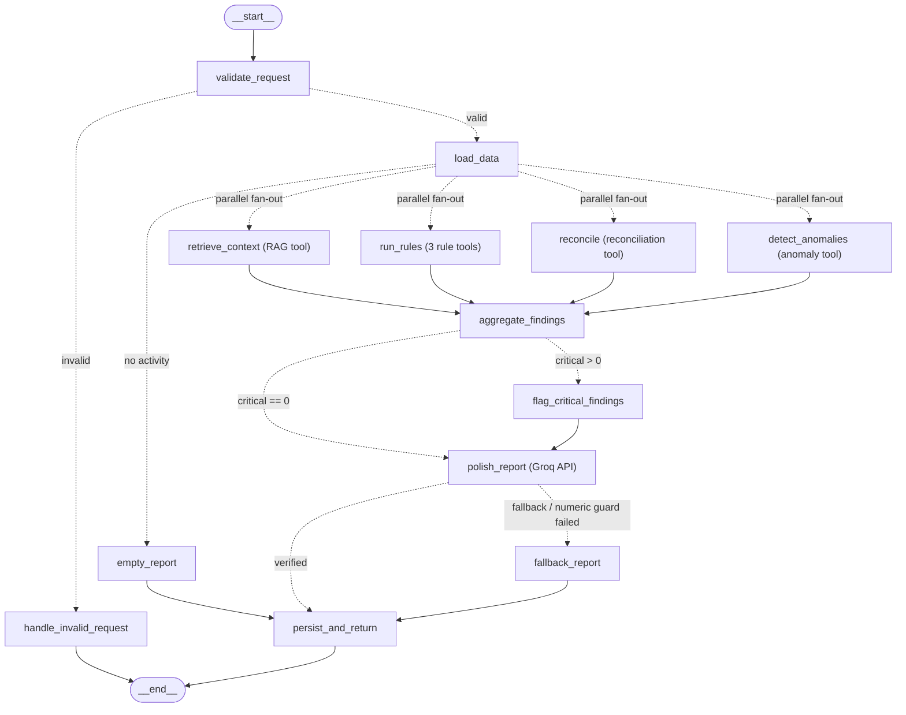

# Financial Audit & LangGraph Workflow

LedgerPilot includes a strictly read-only **Financial Audit** subsystem (`backend/src/ledgerpilot/audit/`) orchestrated as a typed **LangGraph** state machine with checkpointing, deterministic `Decimal` rule & reconciliation tools, tenant-scoped RAG policy retrieval, and a **Groq** plain-language polishing layer guarded against numeric hallucinations.

---

## 1. Step 0 Discovery Summary (Pre-Implementation Baseline vs. Added Capabilities)

Before building this subsystem, the codebase was audited for existing compliance, reconciliation, RAG, and LLM components:

| Capability | Pre-Existing State | Action Taken |
| :--- | :--- | :--- |
| **Audit module (`ledgerpilot/audit/`)** | Contained only `AuditEvent` (`models.py`, `service.py`) — an append-only event log (`business.created`, `journal.posted`, etc.). No financial audit workflow, period scanner, or structured finding engine existed. | Extended `ledgerpilot/audit/` without modifying `AuditEvent` contracts; added `FinancialAuditRun` (`0041_financial_audit_runs.py`) with `ENABLE/FORCE ROW LEVEL SECURITY`. |
| **Deterministic accounting & banking rules** | Spread across `reports/service.py` (`balance_sheet`, `trial_balance`), `accounting/reconciliation.py` (`control_tieouts`, `tax_control_tieout`), `banking/shadow.py` (`BankRule` & restricted keyword guards), `banking/reconciliation.py` (`Statement` sign-off), `workspace/close_packages.py` & `workspace/service.py` (close tasks & prepaids), and `p3_features/service.py` (`SupplierPaymentControl`). | Reused those exact domain invariants and exposed them as 5 read-only `@tool`-decorated deterministic audit tools operating on an immutable snapshot. |
| **RAG / policy context** | Tenant rules, `AiAccountingMemory`, `BusinessPolicyHistory`, `BankRule`, `SupplierPaymentControl`, and `Evidence` records existed in PostgreSQL, along with `sanitize_untrusted_text()` in `ai/adapter.py`, but no vector retriever existed for audit grounding. | Added `audit/rag.py` (`AuditVectorRetriever`), a deterministic TF-IDF + cosine-similarity vector store indexing canonical rule specs plus sanitized tenant policies, memories, bank rules, payment caps, and document metadata. |
| **Groq integration** | `GroqModelAdapter` in `ai/adapter.py` already handled `GROQ_API_KEY` from environment variables, retries with exponential backoff, HTTP 429 `Retry-After`, timeouts, token/cost tracking, and deterministic fallback. | Reused `GroqModelAdapter` inside `audit/polisher.py`, adding hierarchical batch chunking (`CHUNK_SIZE = 12`), `verify_no_invented_numbers()` numeric hallucination rejection, and conditional routing to `fallback_report`. |
| **LangGraph orchestration** | Absent (`langgraph` was not installed). | Added `langgraph` and `langchain-core`, assembling a 13-node `StateGraph(AuditState)` with parallel fan-out/fan-in, conditional edges, and `MemorySaver` checkpointing. |

---

## 2. Audit Modes & Triggers

1. **Monthly audit (`audit_type="monthly"`, `month="YYYY-MM"`)** — Scans all balance sheets, journals, journal lines, bank rows, statements, trade documents, payments, supplier disbursements, and close tasks for the specified calendar month, plus opening-to-closing continuity from the beginning of books.
2. **Yearly audit (`audit_type="yearly"`, `year=YYYY`, `calendar_year=False|True`)** — Scans either the workspace's fiscal year (`business.fiscal_month`, e.g. `FY-2026-2027` when `fiscal_month=7`) or calendar year (`Jan 1..Dec 31` when `calendar_year=True` or `fiscal_month=1`).
3. **Emergency / on-demand audit (`audit_type="emergency"`, optional `start_date`, `end_date`)** — Defaults `start_date` to the earliest recorded financial entry in the workspace and `end_date` to today in the workspace timezone. Supports `run_async=True` (`202 Accepted`) via `BackgroundJob` (`kind="financial_audit"`).
4. **Auto-triggered audits** — Executed automatically (non-mutating, inside a savepoint) whenever:
   - A Balance Sheet is generated (`GET /api/v1/businesses/{business_id}/reports/balance-sheet` -> `audit_type="auto_balance_sheet"`, `trigger_source="balance_sheet_generated"`).
   - An accounting period is locked (`PATCH /api/v1/businesses/{business_id}/periods/{period_id}` with `locked=True` -> `audit_type="auto_period_close"`, `trigger_source="period_locked"`).
   - A period close package is prepared (`POST /api/v1/businesses/{business_id}/close-packages` -> `audit_type="auto_period_close"`, `trigger_source="close_package_prepared"`).

---

## 3. LangGraph Workflow Architecture

### Module Layout (`backend/src/ledgerpilot/audit/`)

- `state.py` — `AuditState` (`TypedDict` with `Annotated[..., operator.add]` reducers), `AuditFindingModel` (Pydantic schema), `RetrievedContextChunk`, immutable `AuditDataset`, and thread-safe `DATASET_REGISTRY`.
- `loader.py` — Bounded (`<= 5000` rows, chunked line reads), strictly read-only SQL snapshot loader enforcing `_verify_rls_scope(db, business_id)`.
- `rag.py` — `AuditVectorRetriever` & `build_tenant_retriever` (TF-IDF + cosine similarity over canonical rules + sanitized tenant policies/memories).
- `tools.py` — Six typed `@tool` functions (`AUDIT_TOOLS`):
  1. `retrieve_audit_context`
  2. `evaluate_banking_rules`
  3. `evaluate_accounting_rules`
  4. `evaluate_payment_and_close_rules`
  5. `reconcile_balances_and_continuity`
  6. `detect_ledger_and_bank_anomalies`
- `polisher.py` — `polish_with_groq`, `build_templated_report`, `collect_allowed_numbers`, and `verify_no_invented_numbers`.
- `nodes.py` — Single-responsibility LangGraph nodes.
- `edges.py` — Conditional routing functions (`route_after_validate`, `route_after_load`, `route_after_aggregate`, `route_after_polish`).
- `graph.py` — `build_audit_graph()`, `execute_financial_audit()`, `SHARED_AUDIT_CHECKPOINTER`, and `get_audit_graph_mermaid()`.
- `triggers.py` — `trigger_auto_audit()` hook for Balance Sheet and Period Close endpoints.
- `router.py` & `schemas.py` — FastAPI endpoints and strict Pydantic contracts.

### Workflow Diagram (`compiled.get_graph().draw_mermaid()`)



<details>
<summary>Raw <code>get_audit_graph_mermaid()</code> output</summary>

```text
graph TD;
	__start__([<p>__start__</p>]):::first
	validate_request(validate_request)
	handle_invalid_request(handle_invalid_request)
	load_data(load_data)
	empty_report(empty_report)
	retrieve_context(retrieve_context)
	run_rules(run_rules)
	reconcile(reconcile)
	detect_anomalies(detect_anomalies)
	aggregate_findings(aggregate_findings)
	flag_critical_findings(flag_critical_findings)
	polish_report(polish_report)
	fallback_report(fallback_report)
	persist_and_return(persist_and_return)
	__end__([<p>__end__</p>]):::last
	__start__ --> validate_request;
	aggregate_findings -.-> flag_critical_findings;
	aggregate_findings -.-> polish_report;
	detect_anomalies --> aggregate_findings;
	empty_report --> persist_and_return;
	fallback_report --> persist_and_return;
	flag_critical_findings --> polish_report;
	load_data -.-> detect_anomalies;
	load_data -.-> empty_report;
	load_data -.-> reconcile;
	load_data -.-> retrieve_context;
	load_data -.-> run_rules;
	polish_report -.-> fallback_report;
	polish_report -.-> persist_and_return;
	reconcile --> aggregate_findings;
	retrieve_context --> aggregate_findings;
	run_rules --> aggregate_findings;
	validate_request -.-> handle_invalid_request;
	validate_request -.-> load_data;
	handle_invalid_request --> __end__;
	persist_and_return --> __end__;
```
</details>

---

## 4. Two-Layer Checking & Groq Numeric Guard

1. **Deterministic Layer (`Decimal` precision = 60, zero LLM math):**
   - Every balance tie-out (`Debit == Credit`, `Assets == Liabilities + Equity + Retained Earnings`, saved `ReportRun` snapshot vs. live ledger, `Opening + Movement == Closing`, inter-period date gaps, `AR`/`AP`/`Loan`/`Tax` subledger control tie-outs), banking rule check, document integrity check, payment approval limit check, and statistical outlier calculation runs purely in Python `Decimal` code.
2. **Contextual RAG Layer (`retrieve_audit_context`):**
   - Retrieves matching canonical rule policies and workspace-specific `AiAccountingMemory`, `BankRule`, `BusinessPolicyHistory`, and `SupplierPaymentControl` context so `aggregate_findings` attaches grounded `[Policy Context · ...]` citations to each finding.
3. **Groq Polishing & Anti-Hallucination Guard (`polish_report` -> `fallback_report`):**
   - `polish_with_groq()` batches large audits (`> 12` findings) into chunks before synthesizing the executive summary and plain-English finding narratives.
   - `collect_allowed_numbers()` harvests all numbers present in the structured findings, summaries, and period dates; `verify_no_invented_numbers()` scans the Groq JSON response and rejects the LLM output if **any** unverified number appears, routing via `route_after_polish` to `fallback_report` (`numeric_guard_passed=False`, `fallback_used=True`).

---

## 5. How to Run Each Audit Mode

### Via HTTP API

All endpoints require an authenticated workspace member with role `owner`, `accountant`, `reviewer`, or `auditor`:

```bash
# 1. Monthly audit (synchronous, HTTP 201)
curl -X POST "http://127.0.0.1:8000/api/v1/businesses/${BUSINESS_ID}/audits" \
  -H "Content-Type: application/json" \
  -d '{"audit_type": "monthly", "month": "2026-11"}'

# 2. Yearly fiscal audit (or set "calendar_year": true for Jan 1..Dec 31)
curl -X POST "http://127.0.0.1:8000/api/v1/businesses/${BUSINESS_ID}/audits" \
  -H "Content-Type: application/json" \
  -d '{"audit_type": "yearly", "year": 2026, "calendar_year": false}'

# 3. Emergency / full-history audit queued asynchronously (HTTP 202 Accepted)
curl -X POST "http://127.0.0.1:8000/api/v1/businesses/${BUSINESS_ID}/audits" \
  -H "Content-Type: application/json" \
  -d '{"audit_type": "emergency", "run_async": true}'

# 4. List past audits (manual + auto-triggered) or fetch a specific run / graph topology
curl "http://127.0.0.1:8000/api/v1/businesses/${BUSINESS_ID}/audits?limit=20"
curl "http://127.0.0.1:8000/api/v1/businesses/${BUSINESS_ID}/audits/${AUDIT_ID}"
curl "http://127.0.0.1:8000/api/v1/businesses/${BUSINESS_ID}/audits/graph"
```

### Via Web UI

Open **Accounting -> Financial audit** (`/financial-audit`), choose **Monthly audit**, **Yearly audit**, or **Full or custom-range audit**, optionally check **Run in background**, and click **Run financial audit**.

### Via Python Service

```python
from ledgerpilot.audit.graph import execute_financial_audit

result = execute_financial_audit(
    db,
    business_id=business_id,
    actor_id=user_id,
    audit_type="monthly",
    request_params={"month": "2026-11"},
)
```

---

## 6. How to Add a New Audit Rule

1. **Expose any new source fields (if needed)** in `AuditDataset` (`backend/src/ledgerpilot/audit/state.py`) and populate them with a bounded, parameterized `select(...)` query in `load_audit_dataset()` (`backend/src/ledgerpilot/audit/loader.py`). Never write or mutate financial rows.
2. **Add canonical policy documentation** in `_CANONICAL_RULE_CHUNKS` (`backend/src/ledgerpilot/audit/rag.py`) with a stable `chunk_id` prefix (e.g. `RULE-INV-001`) and domain `tags` so the RAG retriever automatically grounds findings from your rule.
3. **Implement the deterministic check** inside the appropriate `@tool` function in `backend/src/ledgerpilot/audit/tools.py` (or register a new `@tool` in `AUDIT_TOOLS` and invoke it in `run_rules` inside `nodes.py`), emitting findings via `_make_finding(...)`:
   ```python
   findings.append(
       _make_finding(
           severity="High",
           category="inventory_control",
           rule_violated="RULE-INV-001:NEGATIVE_COST_LAYER",
           affected_records=[str(item_id)],
           expected_vs_actual={"min_quantity": "0", "actual_quantity": str(qty)},
           evidence=[f"SKU {sku} has negative layer quantity {qty}."],
           recommendation="Recalculate cost layers and post a verified inventory adjustment.",
       )
   )
   ```
4. **Add a unit & graph test** in `backend/tests/test_financial_audit_langgraph.py` seeding the violation in `AuditDataset` and asserting the finding ID, severity, RAG citation attachment, and numeric-guarded narrative output.
